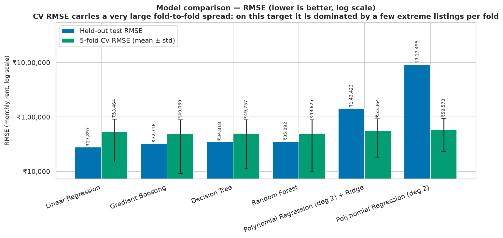
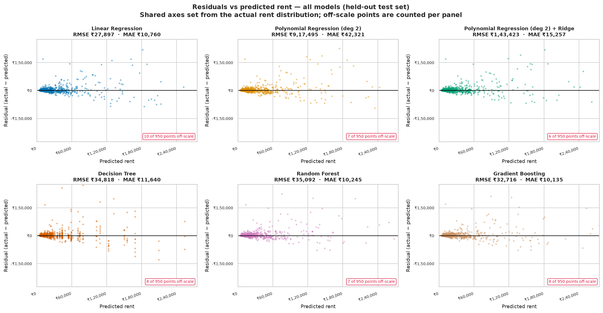
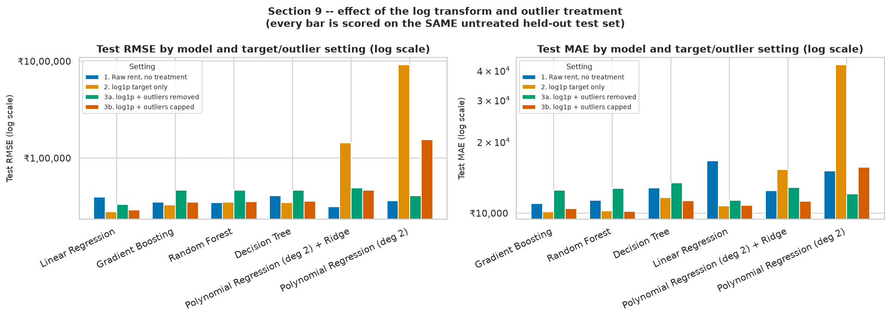
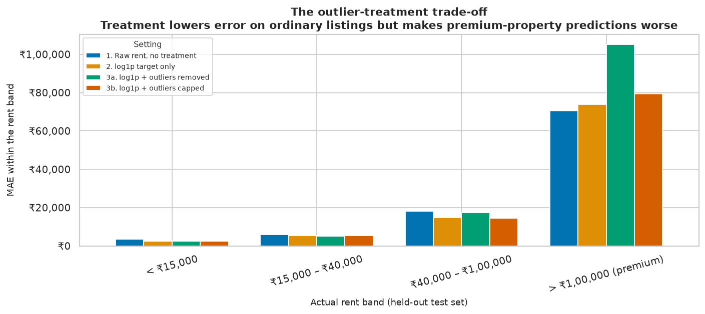
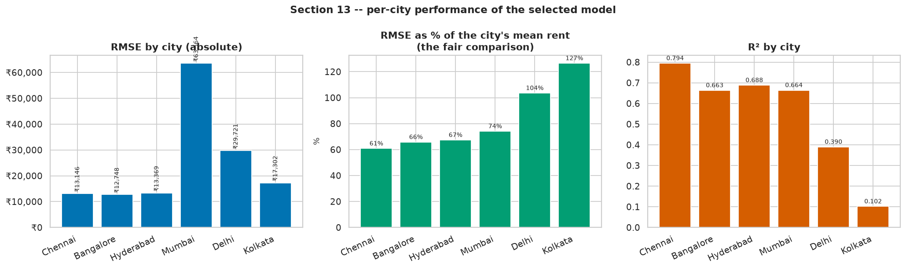
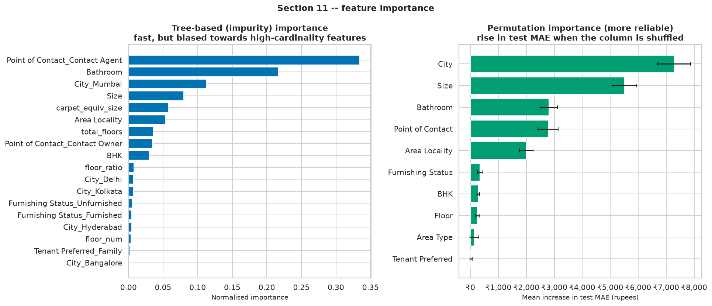

# Residential Rent Prediction

**Case Study 36 · Semester V Machine Learning**

Predicting the monthly rent of a residential unit from its attributes — size,
bedrooms, floor, furnishing, locality and tenant preference — across six Indian
cities, with a Streamlit app for interactive estimation.

| | |
|---|---|
| **Selected model** | Gradient Boosting |
| **Trained under** | 2. log1p target only |
| **Test R²** | 0.7144 |
| **Test RMSE** | ₹32,716 |
| **Test MAE** | ₹10,135 |
| **Test MAPE** | 26.7% |
| **Dataset** | 4,746 listings · 3,796 train / 950 held-out test |
| **Reproducibility** | `RANDOM_STATE = 42` everywhere |

---

## Quick start

```bash
# 1. Create and activate a virtual environment (Python 3.12 recommended)
python3.12 -m venv .venv
source .venv/bin/activate          # Windows: .venv\Scripts\activate

# 2. Install dependencies
pip install -r requirements.txt

# 3. Train everything (~5-10 minutes)
python train.py

# 4. Launch the app
streamlit run app/app.py
```

To rebuild the analysis notebook as well:

```bash
pip install -r requirements-dev.txt
python notebooks/build_notebook.py --exec
python make_readme.py
```

> **scikit-learn is pinned exactly** in `requirements.txt`. The saved pipeline is
> serialised by that exact version; loading it under a different release can break
> unpickling of the `ColumnTransformer` / `TargetEncoder` internals.

### Where the dataset lives

`data/House_Rent_Dataset.csv` — the Kaggle *House Rent Prediction Dataset*
(4,746 rental listings across six Indian cities), with
`data/Dataset Glossary.txt` alongside it. The raw CSV is gitignored; download it
from
[Kaggle](https://www.kaggle.com/datasets/iamsouravbanerjee/house-rent-prediction-dataset)
and place it at that path. `src/data.py` raises a clear error with these
instructions if it is missing — there is deliberately no synthetic fallback, so
every number in this README refers to the real data.

---

## Project layout

```
.
├── data/                      raw CSV + glossary (CSV gitignored)
├── src/                       all reusable logic, shared by notebook AND app
│   ├── config.py              paths, column schema, seed, thresholds
│   ├── data.py                load_data() + the profiling pass
│   ├── preprocess.py          FeatureEngineer, outlier logic, ColumnTransformer
│   ├── models.py              the six model variants and their search spaces
│   ├── evaluate.py            metrics, CV reporting, diagnostic tables
│   └── plots.py               every figure
├── notebooks/
│   ├── build_notebook.py      generates the notebook
│   └── rent_prediction_analysis.ipynb
├── models/                    pipeline.joblib, quantile_*.joblib, metrics.json,
│                              feature_meta.json
├── reports/
│   ├── figures/               every plot
│   └── *.csv                  every comparison table
├── app/app.py                 Streamlit app
├── train.py                   runs the full training pipeline
├── make_readme.py             regenerates this file from metrics.json
└── requirements.txt
```

All preprocessing and feature logic lives in `src/` and is imported by the
notebook, `train.py` and the app. Nothing is duplicated between them.

---

## Method

**Target.** Raw rent has a skew of **21.4** (median
₹16,000, maximum
₹35,00,000 — **219×
the median**). Every model is trained on `log1p(Rent)`, which brings the skew to
0.91. The estimator is wrapped in a
`TransformedTargetRegressor`, so predictions are inverted with `expm1` and **all
reported metrics are in rupees**.

**Feature engineering** (`src/preprocess.py`, a stateful transformer so group
medians are learned on training folds only):

* `Floor` — the string `"Ground out of 2"` is split into `floor_num` and
  `total_floors`, with `Ground` → 0, `Upper Basement` → −0.5,
  `Lower Basement` → −1. 4 rows have no
  "out of" part and so have a genuinely missing `total_floors`, imputed with the
  median for that city. **This is the "handle missing floor values" objective —
  the missing values were hidden inside the string, not stored as NaN.**
* `Size` — 16 listings report under
  50 sq ft (the smallest is
  10). These are treated as missing and imputed with the
  median for the same `(City, BHK)` group.
* `carpet_equiv_size` — `Size` converted to a carpet-area equivalent, with raw
  `Size` and `Area Type` deliberately **kept as features too**.
* `Size × Area Type` interaction terms, added **for the linear and polynomial
  models only** — trees learn that split themselves.

**Encoding.** One-hot for `City`, `Furnishing Status`, `Tenant Preferred`,
`Area Type`, `Point of Contact`, with `handle_unknown="ignore"` (required: two
levels have only 1–2 rows in the whole dataset). `Area Locality` has
2,235 levels of which 1,465 appear exactly once,
so it is **target-encoded with smoothing** rather than one-hot.

> **Leakage guards.** (1) The `TargetEncoder` sits **inside** the pipeline, so it
> is refitted within every CV fold and never sees the validation fold's target.
> (2) `rent_per_sqft` is derived from the target and is used for EDA and outlier
> detection **only** — it is never a model feature.

**Outliers.** Detected with a **per-city** IQR rule on `Rent` plus an extreme
`rent_per_sqft` flag. Per-city matters: a single global IQR bound of
₹67,500
sits barely above Mumbai's median rent and would flag over a third of that city's
listings while flagging almost nothing in Hyderabad.

**Validation.** A 20% test set, split once, stratified by city, **never
outlier-treated and never touched during tuning**. 5-fold `RandomizedSearchCV` on
the remaining 80%.

### Why models are tuned on MAE

The 5-fold CV **RMSE** on this data has a standard deviation of
60%–81%
of its own mean — it is decided by whichever few extreme listings land in a given
fold. CV **MAE** on the same folds has a std/mean of
10%–15%.
Hyperparameters are therefore selected on CV MAE. **R², MSE, RMSE and MAE are all
still reported for every model** — only the tuning criterion changes.

The same effect shows up on the test set: the single worst prediction of
950 accounts for **42%** of total MSE,
and the worst 10 for **77%**. Excluding just the
worst 1% of rows moves RMSE from ₹32,716 to
₹16,234.

---

## Results

### Model comparison — 2. log1p target only

| Model | CV RMSE (mean ± std) | CV MAE (mean ± std) | Test R² | Test MSE | Test RMSE | Test MAE | Test MAPE % |
|---|---|---|---|---|---|---|---|
| Linear Regression | 53,464 ± 38,571 | 12,218 ± 1,381 | 0.7924 | 778,231,590 | 27,897 | 10,760 | 28.4 |
| Gradient Boosting | 49,039 ± 39,836 | 10,874 ± 1,600 | 0.7144 | 1,070,335,994 | 32,716 | 10,135 | 26.7 |
| Decision Tree | 49,757 ± 38,656 | 12,164 ± 1,429 | 0.6766 | 1,212,284,780 | 34,818 | 11,640 | 32.0 |
| Random Forest | 49,625 ± 39,816 | 11,019 ± 1,599 | 0.6714 | 1,231,467,556 | 35,092 | 10,245 | 26.7 |
| Polynomial Regression (deg 2) + Ridge | 55,364 ± 37,036 | 12,258 ± 1,317 | -4.4882 | 20,570,151,120 | 143,423 | 15,257 | 29.6 |
| Polynomial Regression (deg 2) | 58,573 ± 35,070 | 12,488 ± 1,261 | -223.5945 | 841,796,925,976 | 917,495 | 42,321 | 43.0 |

All values in rupees per month except R² and MAPE. CV columns are 5-fold means ±
standard deviation across folds.

> Polynomial Regression is reported as **two rows** — plain degree 2, and degree 2
> with Ridge. The case study names five algorithms; a plain degree-2 expansion
> over ~24 one-hot encoded features produces a few hundred correlated terms and
> overfits badly, so regularisation was added and both are shown to make the
> improvement visible rather than merely asserted.



### Residual plots — all models

The case study lists *Residual Plot* as a comparison metric, not just a
best-model diagnostic.



### The outlier experiment

Every model under four settings. **All of them are scored on the same untreated
test set** — treating the test set too would make the metrics improve simply
because the test set got easier.

**Test RMSE**

| model | 1. Raw rent, no treatment | 2. log1p target only | 3a. log1p + outliers removed | 3b. log1p + outliers capped |
|---|---|---|---|---|
| Decision Tree | 40920.0 | 34818.0 | 46731.0 | 35788.0 |
| Gradient Boosting | 35200.0 | 32716.0 | 46436.0 | 35025.0 |
| Linear Regression | 39566.0 | 27897.0 | 33198.0 | 29242.0 |
| Polynomial Regression (deg 2) | 36384.0 | 917495.0 | 41111.0 | 155554.0 |
| Polynomial Regression (deg 2) + Ridge | 31502.0 | 143423.0 | 49427.0 | 46745.0 |
| Random Forest | 34796.0 | 35092.0 | 46609.0 | 35470.0 |

**Test MAE**

| model | 1. Raw rent, no treatment | 2. log1p target only | 3a. log1p + outliers removed | 3b. log1p + outliers capped |
|---|---|---|---|---|
| Decision Tree | 12789.0 | 11640.0 | 13457.0 | 11280.0 |
| Gradient Boosting | 11006.0 | 10135.0 | 12504.0 | 10447.0 |
| Linear Regression | 16668.0 | 10760.0 | 11334.0 | 10795.0 |
| Polynomial Regression (deg 2) | 15116.0 | 42321.0 | 12056.0 | 15647.0 |
| Polynomial Regression (deg 2) + Ridge | 12470.0 | 15257.0 | 12870.0 | 11218.0 |
| Random Forest | 11334.0 | 10245.0 | 12706.0 | 10204.0 |




> The CV columns in `reports/outlier_experiment.csv` are **not comparable across
> settings** — each setting cross-validates a different training set, so `remove`
> shows a flatteringly low CV RMSE purely because the hard rows were deleted from
> its own folds. Only the `test_*` columns are comparable.

### Per-city performance

| City | Test n | Mean rent | RMSE | MAE | R² | MAPE % | RMSE % of mean | Unseen localities % |
|---|---|---|---|---|---|---|---|---|
| Chennai | 178 | 21,614 | 13,146 | 5,894 | 0.7944 | 26.4 | 61 | 25.3 |
| Bangalore | 177 | 19,382 | 12,748 | 5,357 | 0.6635 | 24.2 | 66 | 36.2 |
| Hyderabad | 174 | 19,846 | 13,369 | 4,967 | 0.6882 | 20.7 | 67 | 22.4 |
| Mumbai | 195 | 85,782 | 63,564 | 25,789 | 0.6642 | 32.7 | 74 | 45.6 |
| Delhi | 121 | 28,708 | 29,721 | 10,100 | 0.3897 | 30.3 | 104 | 31.4 |
| Kolkata | 105 | 13,676 | 17,302 | 4,911 | 0.1018 | 26.6 | 127 | 35.2 |



Best: **Chennai** at 61% RMSE-to-mean
(R² 0.794). Worst: **Kolkata** at
127% (R² 0.102). The drivers are
sample size, rent variance, and the share of test listings sitting in a locality
the model never saw.

### Feature importance

| Feature | MAE increase when shuffled | R² drop when shuffled |
|---|---|---|
| City | 7,290 | 0.3397 |
| Size | 5,506 | 0.3300 |
| Bathroom | 2,804 | 0.2190 |
| Point of Contact | 2,775 | 0.1960 |
| Area Locality | 1,998 | 0.0907 |
| Furnishing Status | 334 | 0.0019 |
| BHK | 279 | 0.0038 |
| Floor | 244 | -0.0102 |
| Area Type | 146 | 0.0074 |
| Tenant Preferred | 23 | -0.0013 |



### Locality ablation

| Model | Test RMSE | Test MAE | Test R² |
|---|---|---|---|
| A: all features | 32,716 | 10,135 | 0.7144 |
| B: without Locality and City | 44,728 | 13,156 | 0.4662 |
| C: only Locality and City | 47,537 | 16,514 | 0.3971 |

Location is the single strongest block of predictors but it does NOT dominate on its own: location-only reaches R² 0.397 versus 0.714 for the full model, so the physical attributes (size, bathrooms, BHK, floor) still contribute materially. Equally, removing location costs 36.7% RMSE, so neither block is redundant.

---

## Final Analysis

### 1. Can monthly rent be predicted from property attributes?

**Yes, with useful but clearly bounded accuracy.** Gradient Boosting reaches
**R² = 0.7144** on 950 held-out listings — about
**71% of the variance in monthly rent** explained by recorded
attributes alone. Typical error is **₹10,135 MAE**
(26.7% of actual rent), and **60%** of
listings are predicted within 25% of their true rent.

The remaining variance is not noise — it is **missing features**. Amenities,
building age, parking and metro proximity all drive rent and none are recorded.

### 2. Which attribute most influences rent?

**Location and size — which ranks first depends on the metric.** By MAE (every
listing weighted equally) **City** is strongest: shuffling it
costs ₹7,290 of average error. By R² drop
(dominated by expensive listings) `Size` ranks first.

Both are correct, and the disagreement is the finding. For an ordinary flat, which
city and locality it sits in matters more than a few hundred square feet; for a
premium flat, floor area is what separates price tiers. Median rent per square
foot: **Mumbai** 71.4 · **Delhi** 28.6 · **Bangalore** 17.5 · **Chennai** 16.2 · **Hyderabad** 14.5 · **Kolkata** 13.3 — a **5.4× spread** across the six cities.

### 3. How does outlier treatment affect the model?

**The log transform helps unambiguously; outlier treatment is a trade-off, not an
improvement.** For Gradient Boosting, on the identical untreated test set:

| Setting | Test RMSE | Test MAE | Test R² |
|---|---|---|---|
| 1. Raw rent, no treatment | ₹35,200 | ₹11,006 | 0.6694 |
| 2. log1p target only | ₹32,716 | ₹10,135 | 0.7144 |
| 3a. log1p + outliers removed | ₹46,436 | ₹12,504 | 0.4247 |
| 3b. log1p + outliers capped | ₹35,025 | ₹10,447 | 0.6727 |

Removing or capping extreme rents improves the error on ordinary listings and
worsens it on expensive ones — a model trained with premium listings deleted has
never seen a flat of that kind and regresses them towards the ordinary market.

**The trap this experiment exists to expose:** under `remove` the *cross-validated*
RMSE looks dramatically better, because those folds no longer contain the hard
rows. Scoring everything on one untreated test set is what makes the real effect
visible. The case study's premise is confirmed — a few premium properties distort
the regression badly on a raw target — but the right remedy is the **log
transform**, not deletion.

### 4. Does locality dominate the other predictors?

**No — it is the strongest single block, but it does not dominate.** Removing
`Area Locality` and `City` costs
**37% of RMSE**
(R² 0.714 → 0.466). But location *alone*
reaches R² **0.397**, only
**56%** of the full model's
0.714. Knowing where a flat is tells you more than any other
single fact — but you still need to know how big it is.

### 5. Which algorithm achieves the lowest RMSE?

**Linear Regression**, at **₹27,897** test RMSE
(MAE ₹10,760, R² 0.7924). Full
ranking in the comparison table above.

Note the caveat established earlier: RMSE on this data is decided by a handful of
listings, so the RMSE ranking is not robust. The deployed model was chosen on
several criteria rather than on RMSE alone — see below.

**Why the lowest-RMSE model was not the one deployed.** Linear Regression attains the lowest test RMSE (₹27,897 vs ₹32,716) and the highest test R² (0.792 vs 0.714), while Gradient Boosting attains the lowest test MAE (₹10,135 vs ₹10,760) and MAPE (26.7% vs 28.4%). The mechanism is extrapolation: a linear model fitted in log space keeps extending its trend beyond the range of rents it was trained on, so it gets closer on the handful of very expensive test listings that dominate squared error. A tree ensemble cannot extrapolate at all -- its predictions are bounded by the leaf values it learned -- so it under-predicts those few properties and pays heavily in RMSE, while fitting the other ~99% of listings more accurately. Since the deployed tool estimates rent for ordinary listings, the model with the lower typical error is selected, and the RMSE trade-off is documented rather than hidden.

### 6. How well does the model perform on new listings?

On the 950-listing held-out test set, never seen during training
or tuning:

* **MAE ₹10,135**, MAPE 26.7%
* **25%** predicted within 10% of actual rent,
  **60%** within 25%
* Best city **Chennai** (61% RMSE-to-mean),
  worst **Kolkata** (127%)
* Mean residual ₹2,905 — no systematic over- or under-prediction
* 80% prediction interval achieves **77.8%** empirical
  coverage, median width 74% of actual rent

Error grows with rent: the model controls *proportional* error, so a constant
percentage becomes a larger rupee error at the top of the market.

### 7. Can the model be deployed as a rent estimation tool?

**Yes — as a decision aid with an explicit uncertainty band, not as a valuation
engine.**

Supporting it: the whole preprocessing chain is inside one pipeline, so the app
loads a single artifact and does **no preprocessing of its own** (no
training/serving skew); single-row prediction takes
**6.5 ms**; it ships a real 80% prediction interval
rather than a bare point estimate; and it is reproducible end to end.

Against it: six cities only; a 89-day snapshot of
2022; asking price ≠ negotiated rent; premium properties systematically
under-predicted; unseen localities silently degrade to a city-level estimate.

**Verdict:** deployable as a suggested-rent field with the range shown and limits
disclosed. **Not** deployable as an automated pricing engine.

### Rubric section 7 — the five determinations

| Determination | Answer |
|---|---|
| Attributes with the greatest effect on rent | Location (`City`, `Area Locality`) and `Size`; rank depends on MAE vs R² weighting |
| Best-performing algorithm | Gradient Boosting (selected on multiple criteria; lowest RMSE was Linear Regression) |
| Effect of outlier treatment | Log transform helps unambiguously; removal/capping trades typical-listing accuracy for premium accuracy |
| Does locality dominate all other attributes | No — strongest single block, ~56% of explained variance on its own |
| Limitations across different cities | Error ranges from 61% to 127% of mean rent by city |

---

## Model selection justification

| model | test_rmse | test_mae | test_r2 | test_mape | overfit_gap_rmse | cv_overfit_gap_rmse | cv_rmse_mean | cv_rmse_std | cv_mae_std | predict_latency_ms |
|---|---|---|---|---|---|---|---|---|---|---|
| Gradient Boosting | 32715.99 | 10134.77 | 0.71 | 26.74 | -25322.64 | -5753.19 | 49039.29 | 39835.51 | 1600.24 | 6.53 |
| Random Forest | 35092.27 | 10244.5 | 0.67 | 26.75 | -18145.93 | -2237.31 | 49625.36 | 39815.78 | 1599.08 | 13.25 |
| Linear Regression | 27896.8 | 10759.99 | 0.79 | 28.42 | -37930.55 | -10973.68 | 53464.26 | 38571.0 | 1381.29 | 7.12 |
| Decision Tree | 34817.88 | 11639.68 | 0.68 | 32.03 | -26507.99 | -9937.11 | 49757.02 | 38656.49 | 1429.34 | 8.11 |
| Polynomial Regression (deg 2) + Ridge | 143422.98 | 15256.54 | -4.49 | 29.62 | 81261.58 | -6953.03 | 55364.23 | 37036.02 | 1316.82 | 8.16 |
| Polynomial Regression (deg 2) | 917494.92 | 42321.12 | -223.59 | 42.97 | 854799.65 | -4178.03 | 58573.18 | 35070.47 | 1261.23 | 7.59 |

| model | rank_test_mae | rank_test_rmse | rank_abs_cv_gap | rank_cv_mae_cv | rank_total |
|---|---|---|---|---|---|
| Gradient Boosting | 1.0 | 2.0 | 2.0 | 3.0 | 8.0 |
| Random Forest | 2.0 | 3.0 | 1.0 | 2.0 | 8.0 |
| Linear Regression | 3.0 | 1.0 | 3.0 | 1.0 | 8.0 |

Shortlisted within 10% of the best test MAE: Gradient Boosting, Random Forest, Linear Regression.
**Selected: Gradient Boosting.**
**Runner-up: Random Forest** — test RMSE ₹35,092, MAE ₹10,245, R² 0.6714.

**Two details in the ranking.** The CV gap is ranked on its **absolute** value —
a large *negative* gap is not extra generalisation, it means the training folds
happened to hold the extreme listings, and the ideal is a gap near zero either
way. CV stability is ranked on std ÷ mean rather than raw standard deviation, so
a model is not rewarded merely for having smaller errors overall.

**On the train-vs-test gap.** The raw gap is misleading here: the single
₹35,00,000 listing falls in the *training* split, inflating
train RMSE by one row so the gap can come out negative for a model that is not
underfitting. The **CV gap** column — 5-fold validation RMSE minus 5-fold training
RMSE on the same data — is the sound generalisation check and is what the
selection ranks on.

**Interpretability.** Linear and polynomial models expose signed coefficients that
can be read directly, which matters when explaining an estimate to a landlord.
Tree ensembles need permutation importance or SHAP to be explained at all.

**Prediction speed.** Every candidate predicts a single row in single-digit to
low-tens of milliseconds — comfortably interactive, so speed does not discriminate
between them here. It would matter for bulk scoring of a whole listings database.

---

## Limitations

1. **Small dataset** — 4,746 listings, 3,796 used for
   training. Thin evidence for a problem with this much local variation.
2. **Thin per-locality coverage** — 2,235 distinct localities, of
   which 1,465 appear exactly once
   (31% of all rows).
3. **Only six cities** — Mumbai, Delhi, Bangalore, Chennai, Hyderabad, Kolkata.
   Nothing here transfers to Pune, Ahmedabad or any tier-2 city.
4. **A 89-day window**
   (2022-04-13 to 2022-07-11) — no inflation, no
   seasonality, no market drift, and the rupee levels are from 2022.
5. **Missing features** — no amenities, building age, parking, metro proximity,
   security, society quality or view. The main reason two similar-looking flats
   get the same estimate when their real rents differ.
6. **Listing price ≠ negotiated rent** — the target is the asking price,
   systematically above what tenants actually pay.
7. **Unseen localities fall back to the global average**, and the prediction
   interval does not currently widen to signal it.
8. **Outlier treatment makes premium predictions unreliable** — quantified in the
   banded MAE table.
9. **`Area Type` is reported inconsistently** — the observed super-to-carpet size
   ratio is ≈1.0, not the conventional 0.70, so sizes are not measured on a
   consistent basis across listings.
10. **Accuracy varies sharply by city** — a single headline number overstates
    performance in the weaker cities.

---

## Real-world applicability

**Who would use it.** Landlords sanity-checking an asking price; tenants judging
whether a listing is fairly priced; rental platforms pre-filling a suggested rent,
flagging listings far outside the model's range, or detecting bait listings.

**How it would be integrated.** As a suggested-rent field in the listing creation
flow — showing the *range*, always overridable, labelled as an estimate from
comparable listings. Server-side it is one joblib artifact behind a thin endpoint;
the pipeline design means serving code builds a DataFrame and calls `predict`,
with no preprocessing to keep in sync.

**Retraining cadence.** Monthly is appropriate, quarterly the absolute minimum.
The full run takes 8 minutes, so cost is not the
constraint. Trigger on calendar schedule *and* on drift detection — monitor
prediction-versus-actual error on new listings and retrain early if it shifts.

**What data would most improve it.**
1. **Geocoordinates instead of free-text locality names** — this alone would fix
   the unseen-locality problem, since an unknown point still has neighbours.
2. **Amenities and building age** — the largest block of missing signal.
3. **Actual transacted rent** rather than asking price — removes a systematic
   bias rather than just reducing variance.
4. **Time-to-let** as a demand signal.
5. **More history**, so seasonality and inflation become learnable.

**What could go wrong.** *Anchoring* — if landlords price to the model's
suggestion, next year's training data reflects the model's own predictions and it
ends up measuring itself. *Entrenched inequity* — thin-data localities are pulled
towards the global average, so systematic under-estimation in underserved areas
could suppress prices there while the model looks accurate on aggregate. *False
precision* — a single rupee figure implies confidence the model does not have,
which is why the app shows an interval. *Premium-segment failure* — the segment
where the most money is at stake is the one predicted worst. *Silent staleness* —
nothing in a deployed model announces that its training data is years old.

---

## Deploying on Streamlit Community Cloud

1. Push the repository to GitHub. **The raw CSV is gitignored**, so either commit
   it deliberately (remove the `data/House_Rent_Dataset.csv` line from
   `.gitignore`) or have the app read it from a URL — the app needs
   `models/*.joblib` and `models/*.json`, which are produced by `train.py`.
2. Commit the trained artifacts: `models/pipeline.joblib`,
   `models/quantile_low.joblib`, `models/quantile_high.joblib`,
   `models/metrics.json`, `models/feature_meta.json`, and `reports/figures/`.
   `models/*.joblib` is gitignored by default — force-add it with
   `git add -f models/*.joblib`, or run `train.py` as part of the build.
3. At [share.streamlit.io](https://share.streamlit.io) create a new app pointing
   at `app/app.py` on your branch.
4. Set the Python version to **3.12** and let it install `requirements.txt`.

> **The one deployment gotcha.** `models/pipeline.joblib` references
> `src.preprocess.FeatureEngineer`, so the project root must be importable before
> `joblib.load` runs. `app/app.py` already inserts it into `sys.path` at the top —
> keep that, or the app fails with `ModuleNotFoundError: No module named 'src'`
> while working perfectly on your machine.

---

## Reproducibility

`RANDOM_STATE = 42` is threaded through the train/test
split, every `RandomizedSearchCV`, the CV splitters, the `TargetEncoder`'s
internal cross-fitting and every model that accepts a seed. Re-running
`python train.py` reproduces these numbers exactly, on
scikit-learn 1.9.1.
